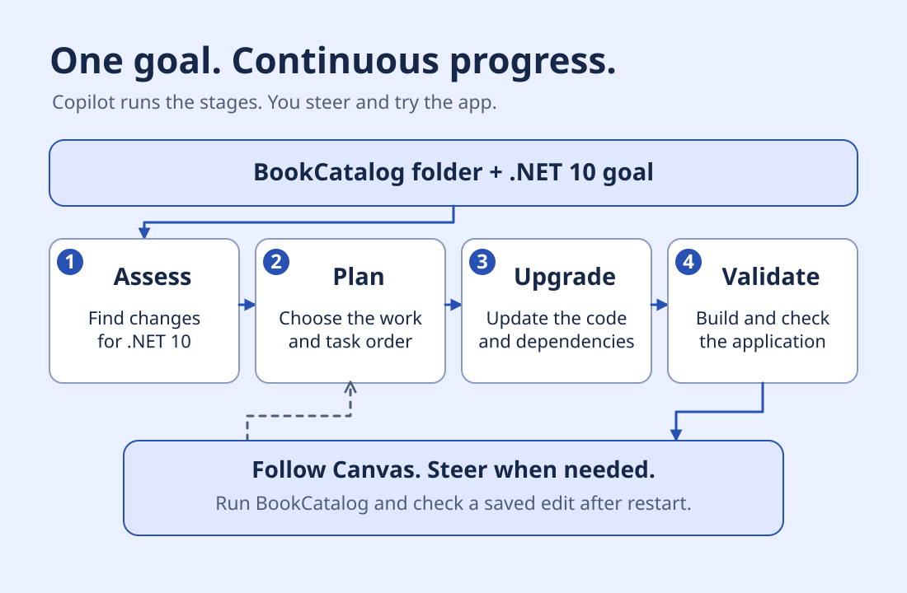
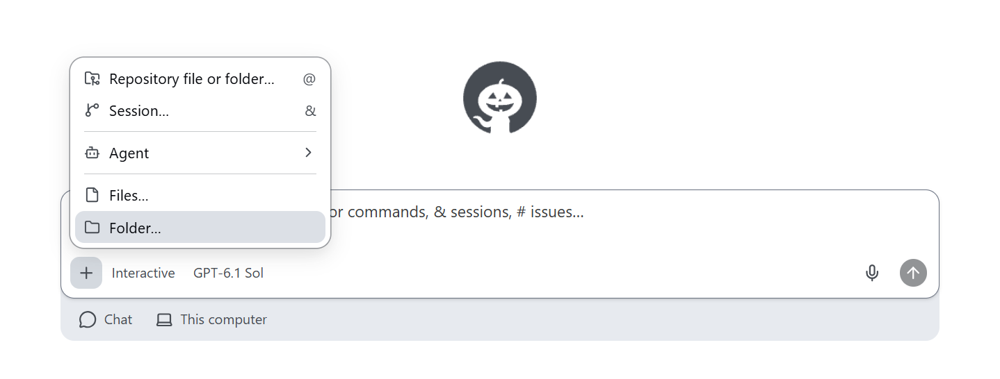
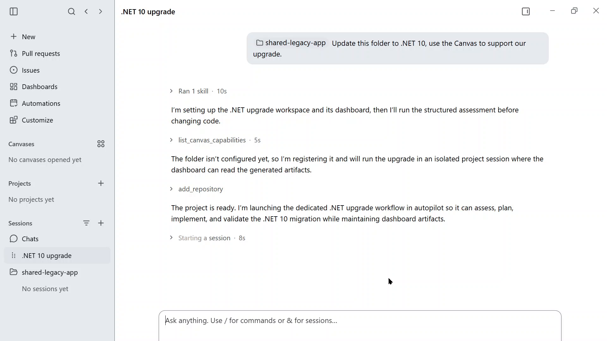
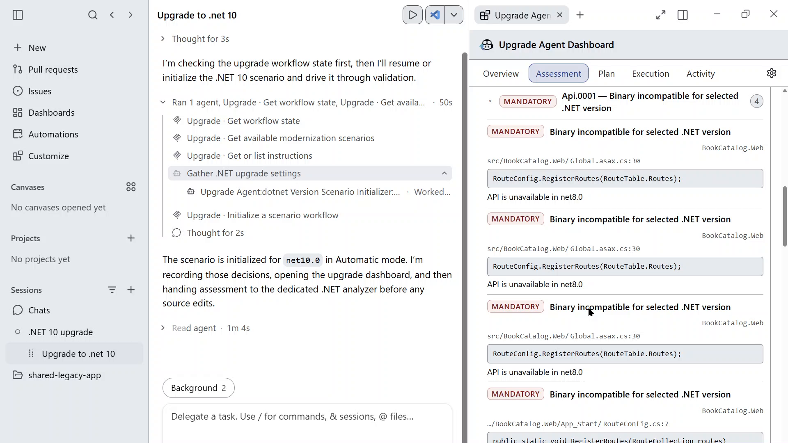
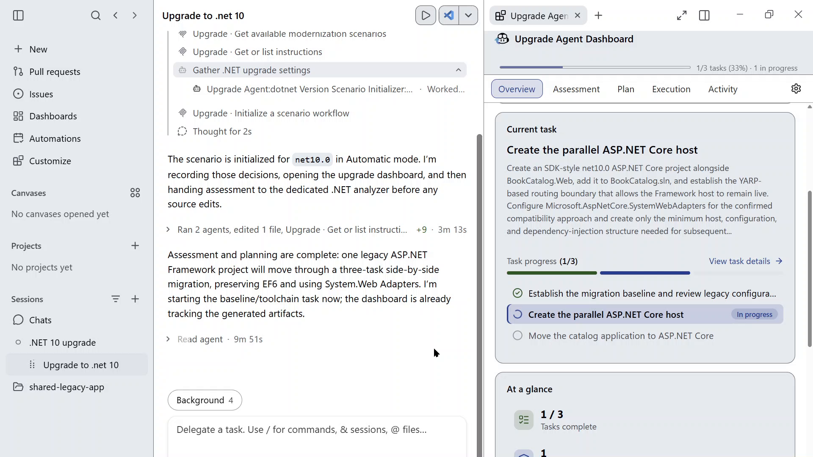
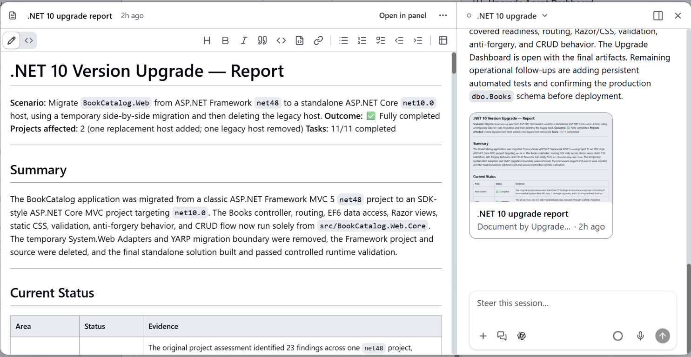

# Modernize with the GitHub Copilot app

Give Copilot a goal and let it work through the upgrade.
In this lesson, you'll attach BookCatalog's folder, start an Autopilot session, and try the resulting .NET 10 app.
The agent handles assessment, planning, code changes, and validation.

Complete [Setup](README.md) first so the original BookCatalog app runs.
If you already upgraded that copy through Visual Studio, start from a fresh learner copy.
This optional route keeps Entity Framework 6 (EF6), which reads and saves the book records.



## Add the BookCatalog folder

Open the [GitHub Copilot app](https://github.com/github/app#install) and sign in with your Copilot account.

1. Start a new chat.
2. Select **+** in the prompt box.
3. Select **Folder...**.
4. Choose `shared-legacy-app` inside your learner copy.
5. Keep **This computer** as the environment.
6. Open the session-mode menu and select **Autopilot**.
7. Under **Tool permissions**, select **Approve all**.



[Open the full-size folder menu](images/copilot-app-add-folder.png).

The folder is added to the conversation context.
The .NET upgrade workflow is included in the app and activates when you ask for the upgrade.
You don't need a separate extension installation or manual agent selection.

**Approve all** lets the agent edit files and run tools without asking for each operation.
Autopilot keeps the work moving without requiring a new prompt at each stage.

## Ask for the upgrade

With the folder attached, send:

```text
Update this folder to .NET 10, use the Canvas to support our upgrade.
```



[Open the full-size upgrade request](images/copilot-app-request.png).

A **canvas** is a panel inside the app for a document or workflow.
The agent opens the Upgrade Agent Dashboard canvas and creates a **scenario**, which keeps this upgrade's files together.
It then works through the stages automatically.
You don't need to send separate requests to assess, plan, execute, or continue between stages.

## Follow the work in the dashboard

Use the dashboard to see what the agent is doing:

| Tab | What to look at |
| --- | --- |
| **Overview** | Current task and overall progress |
| **Assessment** | Compatibility findings for BookCatalog and the .NET 10 target |
| **Plan** | The chosen approach and the work needed |
| **Execution** | Tasks, changes, and validation results |
| **Activity** | Workflow events and any interruptions |



[Open the full-size assessment](images/copilot-app-assessment.png).

The agent may use a **side-by-side migration**.
That adds a new ASP.NET Core host, the process that serves the book pages, while the Framework host remains available.
Temporary adapters and proxy routing let the pages move in stages.
EF6 remains responsible for the book data.



[Open the full-size upgrade progress](images/copilot-app-core-host.png).

The agent continues from the assessment into the plan, then makes changes and runs its checks.
Task counts can change as it breaks work into smaller tasks.
The upgrade can take a while. Let it continue rather than starting another upgrade session.

If Copilot needs a decision, answer in the same conversation.
You can also steer it while it works without starting the workflow again.

## Review the upgraded app

When the upgrade finishes, open **Changes**.
Check that the web app targets `net10.0` and that the book list and forms remain.
For this route, EF6 stays in place. Don't apply the Visual Studio route's EF Core database-recreation steps.

If the Framework host remains, first check that the new host serves the catalog and saves book edits.
Then tell Copilot: `Remove the old .NET Framework host and finish with the standalone .NET 10 app.`
Autopilot updates the plan, removes the temporary migration dependencies, and reruns validation.
You don't need separate planning and execution prompts for that change.

Open the final report card or document in Canvas.
The report summarizes the changes, build results, and remaining work.



[Open the full-size report](images/copilot-app-report-canvas.png).

Read which build and runtime checks ran.
A completed task list doesn't replace trying the application yourself.

## Try BookCatalog on .NET 10

Use the app URL from the agent's launch results.
If the app isn't running, ask Copilot to start the upgraded BookCatalog.
Use the new app, not the original IIS Express profile.

1. Check that active books appear in title order.
2. Open a book's details page.
3. Add a sample book with a title, author, and **Active** selected.
4. Edit its title and save.
5. Ask Copilot to restart the app.
6. Confirm that the changed title remains.
7. Submit a form without a title and confirm that validation prevents saving.

If something fails, describe it in the same conversation.
For a build or runtime error, include the complete error.
Let Copilot fix the problem, then repeat the check.

Keep the changed application, scenario files, and final report in your learner copy.
Finish when the .NET 10 app builds, opens, and keeps a saved edit after restart.

**[Back: Setup](README.md)** · **[Course overview](../README.md)**

## Reference

- [Copilot app upgrade example](../examples/assessments/copilot-app/README.md)
- [GitHub Copilot app quickstart](https://docs.github.com/en/copilot/get-started/quickstart-copilot-app)
- [Session modes and tool permissions](https://docs.github.com/en/copilot/how-tos/github-copilot-app/agent-sessions)
