# BookCatalog: a Copilot app upgrade example

<!-- repo-only:start -->
> [!TIP]
> **Prefer the web experience?** [Open this page on the course website](https://microsoft.github.io/dotnet-modernization-for-beginners/#/reference?path=examples%2Fassessments%2Fcopilot-app%2FREADME.md) for the best reading experience and navigation.
<!-- repo-only:end -->

This example documents a BookCatalog upgrade using the GitHub Copilot desktop app on October 30, 2026.
It starts with .NET Framework 4.8 and ends with an agent-reported standalone ASP.NET Core MVC app on .NET 10.
EF6 remains the data-access library.

Follow [Modernize with the GitHub Copilot app](../../../03-prerequisites/copilot-app.md) for the learner steps.
The screenshots here describe one run. They aren't checks of another generated application.

## Assessment and migration

The prompt box accepts a local folder through **+ > Folder...**.
The selected folder becomes conversation context without a separate repository-registration step.

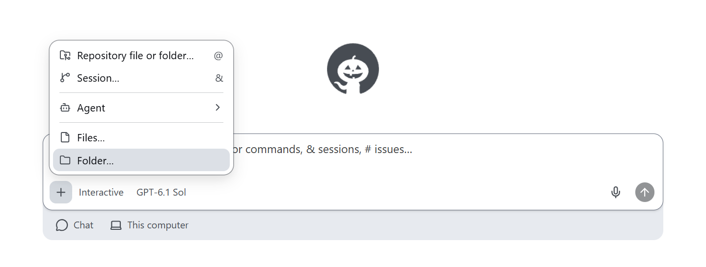

The initial request selects the `shared-legacy-app` folder and asks for .NET 10 with a dashboard canvas.

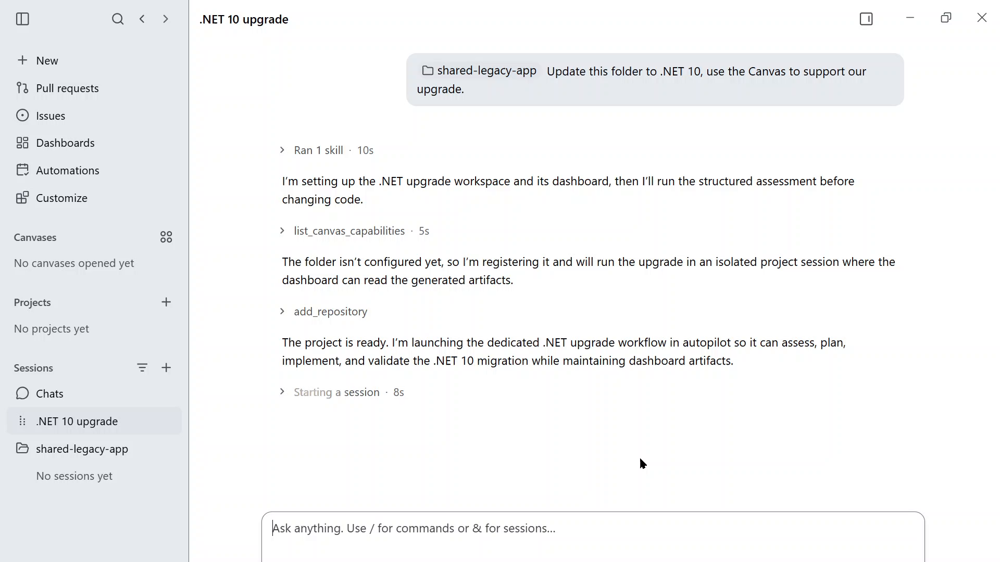

The assessment identifies incompatible route-registration APIs.
Some finding text names `net8.0`, although the selected scenario target is `net10.0`.
That mismatch needs explanation rather than changing the intended target.

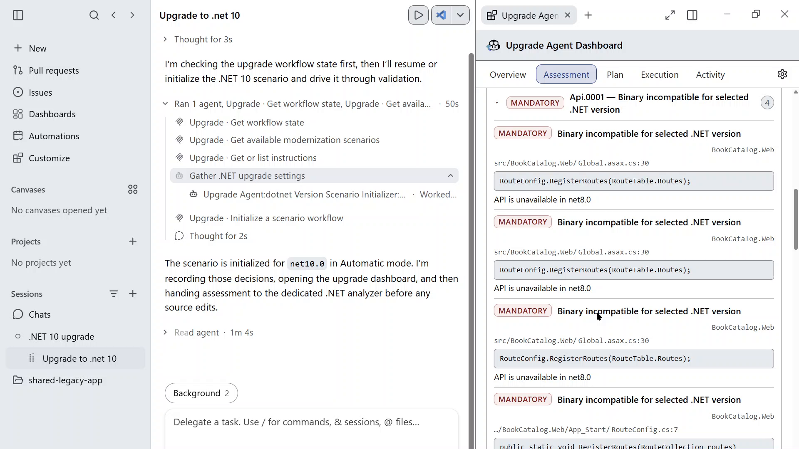

The plan begins with baseline checks, a parallel host, and migration of the catalog.

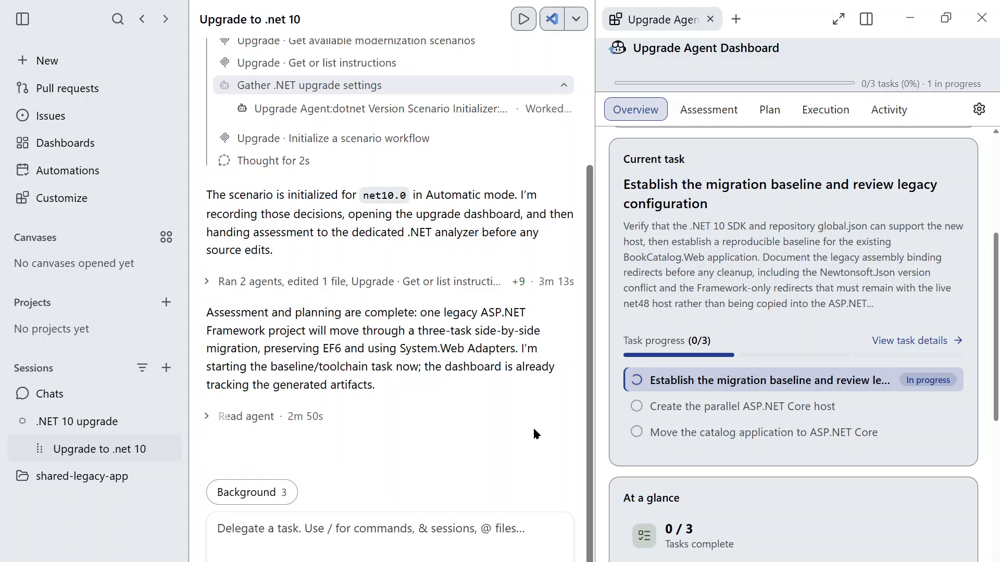

The parallel-host task introduces ASP.NET Core alongside the Framework host.
Its temporary routing uses adapters and a YARP reverse proxy.

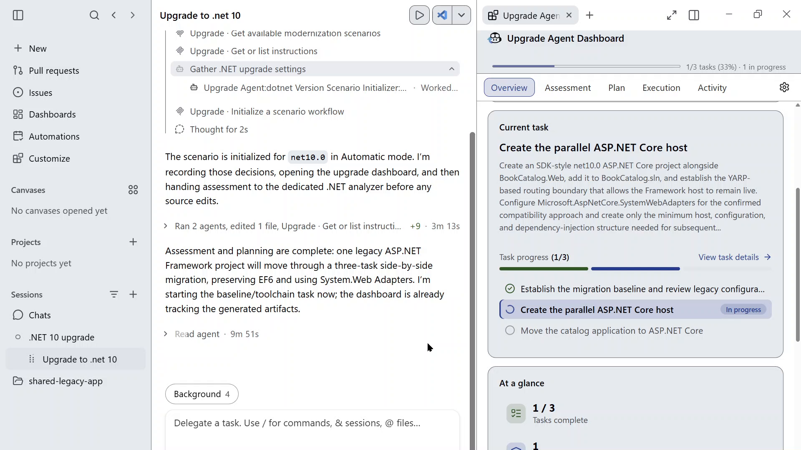

The agent then moves the book controller, routes, Razor views, and styles.
The plan keeps the EF6 data model and shared lab schema.

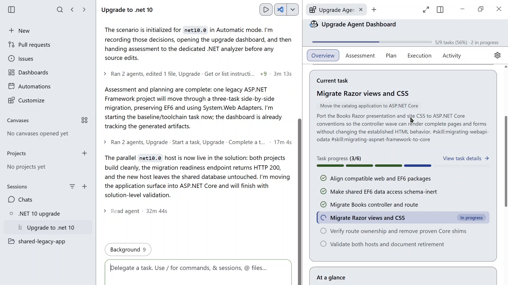

At 88:00, the video shows 9 of 11 tasks complete, with final validation still in progress.
This frame isn't the final state shown in the later screenshots.

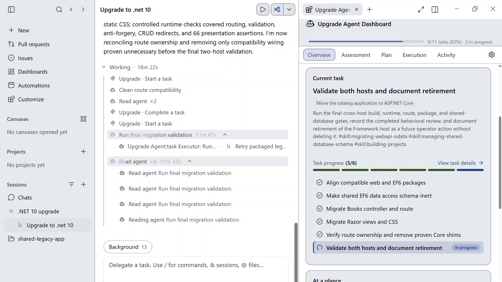

## Changing the end state

The learner asks why the Framework host remains and authorizes its removal.
The agent explains that it had retained the host as a fallback.
It revises the plan to remove the host and validate one standalone .NET 10 app.

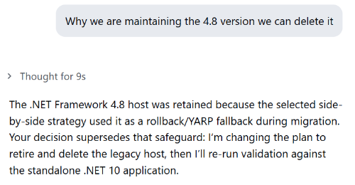

The later completion message reports removal of the Framework project, YARP, and unused compatibility dependencies.
It reports a successful Release build and controlled runtime checks.
It also states that no test project existed in that workspace, so automated tests were not run.

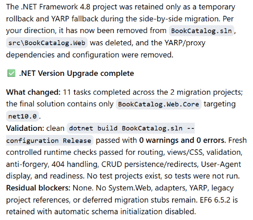

A refreshed summary reports **11/11 tasks complete** and the saved plan's changed end state.

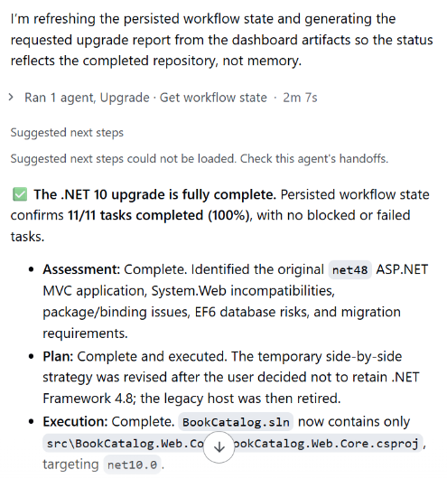

## Task completion and build records

The dashboard shows all tasks complete, but its build card says **Not run yet** and **No build recorded in this session**.
That missing record doesn't independently establish whether the reported build command passed or failed.

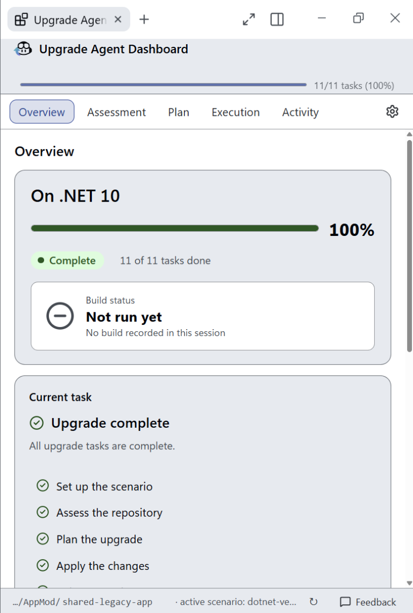

The **Execution** tab reports 11 complete tasks, with none in progress or failed.

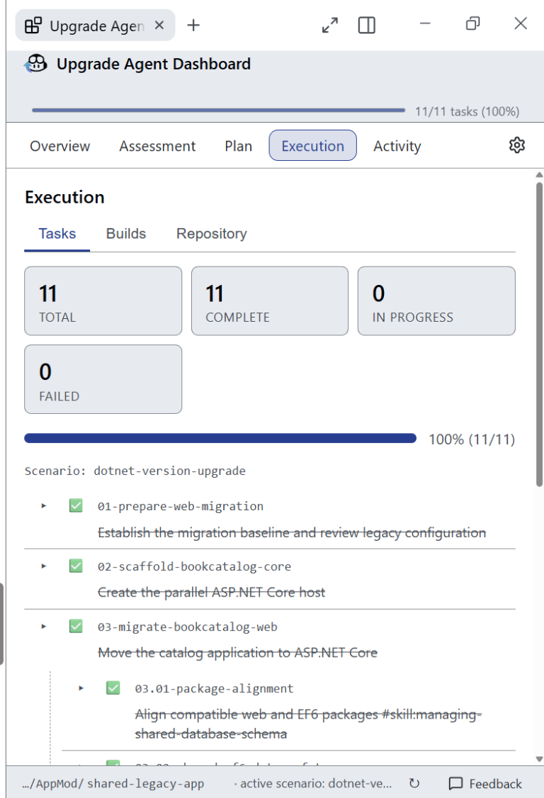

## Final report in Canvas

The conversation offers the final report as a document card.
The message identifies automated tests and production schema checks as follow-up work.
It doesn't authorize deployment.

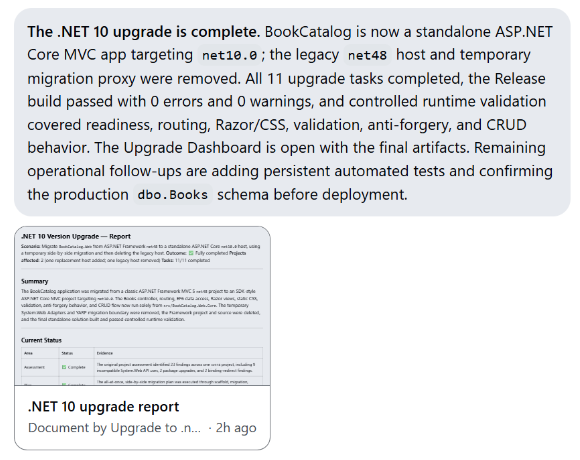

The report describes one replacement host added, one legacy host removed, and EF6 retained.

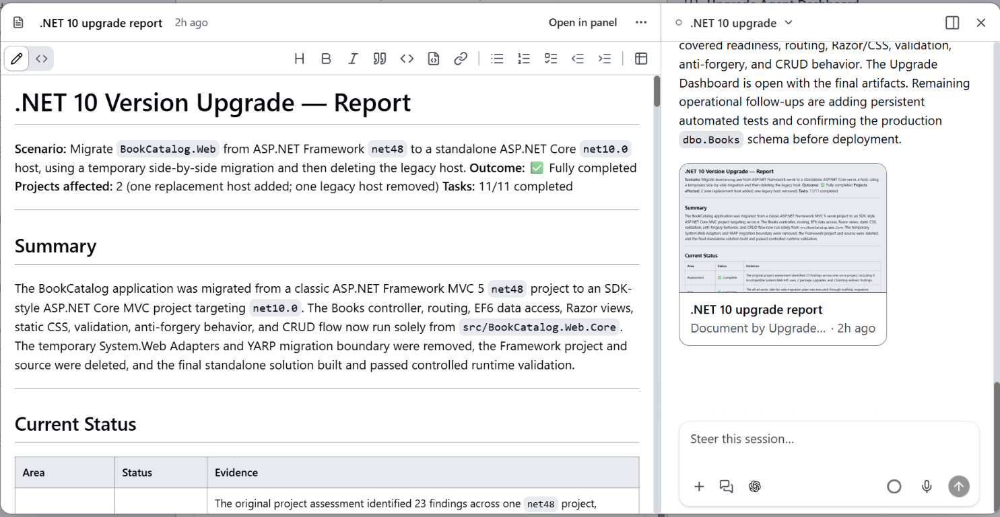

These screenshots establish agent-reported completion, not independently rerun verification of the generated application.
They don't establish the learner's browser persistence result.
Use the lesson's build and add/edit/restart checks on the actual application.

## Source notes

The six video frames are from 01:00, 03:00, 08:00, 15:00, 55:00, and 88:00.
Additional screenshots cover the folder menu, plan revision, completion messages, dashboard, and report.
Chat screenshots are cropped to omit account details and personal filesystem paths. Their retained text is unchanged.
The source commit and installed app and plugin versions weren't recorded.
Counts, model names, and UI labels can differ between runs.

**[Back: Copilot app lesson](../../../03-prerequisites/copilot-app.md)**
